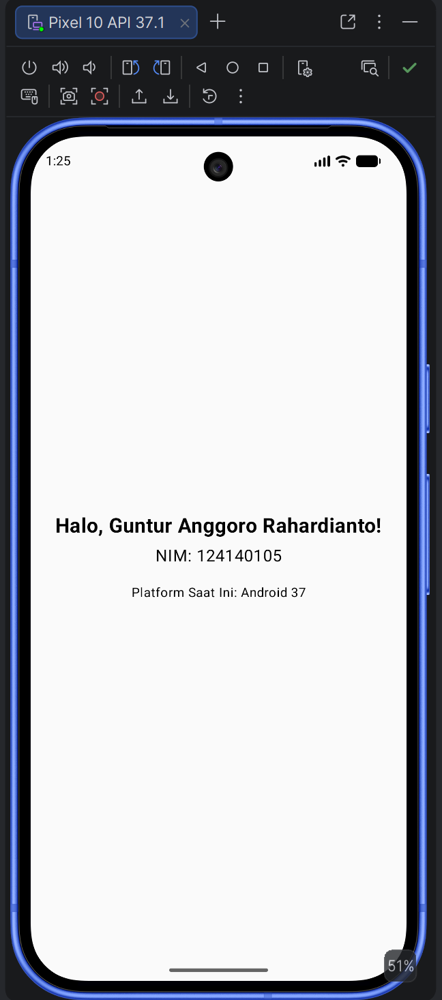
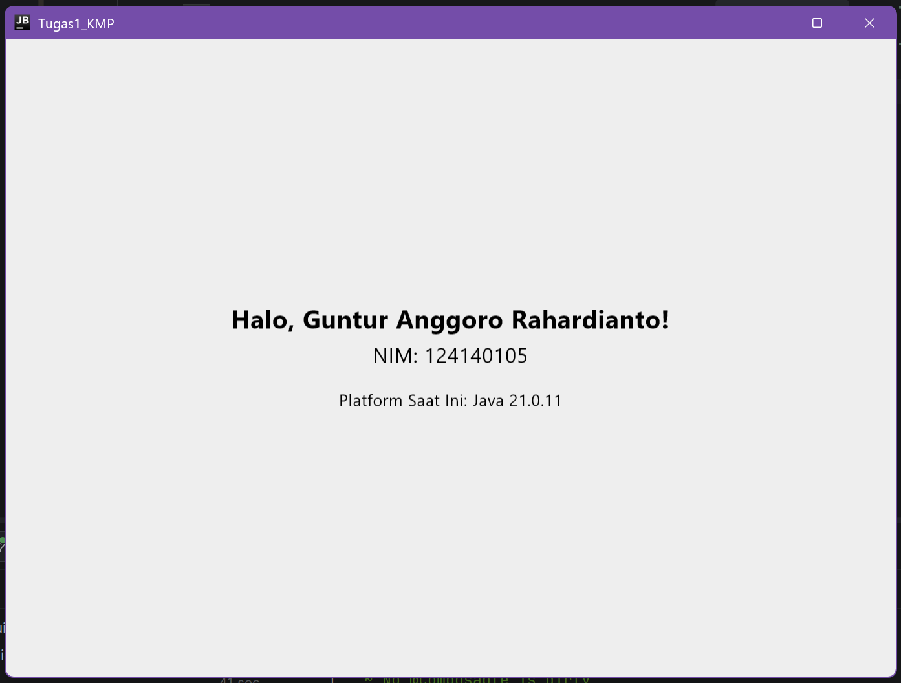

# Tugas 1 - Pengembangan Aplikasi Mobile

Aplikasi Hello World sederhana menggunakan **Kotlin Multiplatform (KMP)** dan **Compose Multiplatform** untuk platform Android dan Desktop.

## Identitas
* **Nama:** Guntur Anggoro Rahardianto
* **NIM:** 124140105
* **Program Studi:** Teknik Informatika
* **Mata Kuliah:** Pengembangan Aplikasi Mobile (IF25-22017)

---

## Tampilan Aplikasi

### 1. Android App

### 2. Desktop App
