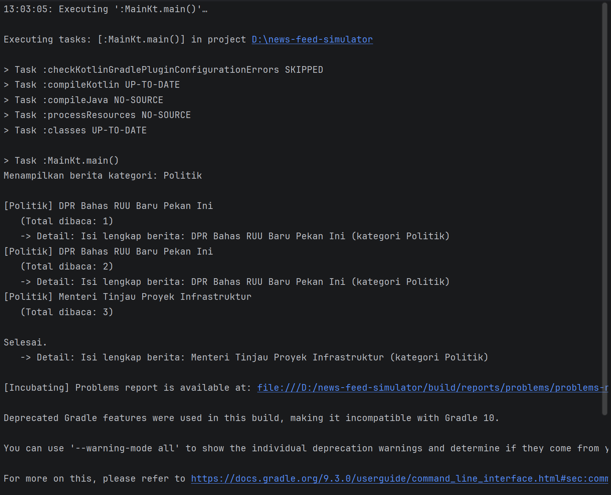

# News Feed Simulator

Tugas Praktikum - Pengembangan Aplikasi Mobile  
Simulasi news feed sederhana menggunakan Kotlin Coroutines dan Flow  
Nama : Guntur Anggoro Rahardianto  
NIM : 124140105  
Kelas : RB  

## Fitur

1. **Flow berita baru setiap 2 detik** - `NewsRepository.newsFlow()` menggunakan `flow { }` builder dengan `delay(2000L)`.
2. **Filter berdasarkan kategori** - operator `.filter { }` di `Main.kt`.
3. **Transform ke format tampilan** - operator `.map { }`, mengubah `NewsItem` menjadi `DisplayNews`.
4. **StateFlow jumlah berita dibaca** - `ReadCounterManager` (`MutableStateFlow` + `asStateFlow()`).
5. **Coroutine async untuk detail berita** - `fetchNewsDetail()` (suspend fun) dipanggil lewat `launch { }` agar tidak memblokir flow utama.

## Struktur Proyek

src/main/kotlin/  
├── Main.kt # Entry point  
├── model/News.kt # Data class: NewsItem, NewsDetail, DisplayNews  
├── data/NewsRepository.kt # Flow simulator + suspend fetchNewsDetail  
└── state/ReadCounterManager.kt # StateFlow penghitung berita dibaca

## Cara Menjalankan

1. Buka project ini di Android Studio / IntelliJ IDEA (`File > Open`).
2. Tunggu Gradle sync selesai.
3. Buka `src/main/kotlin/Main.kt`, klik ▶ di sebelah `fun main()`.
4. Untuk mengganti kategori yang difilter, ubah nilai variabel `kategoriPilihan` di `Main.kt`.

## Kategori yang Tersedia

Teknologi, Olahraga, Politik (bisa ditambah/diubah di `NewsRepository.kt`).

## Tampilan setelah run

