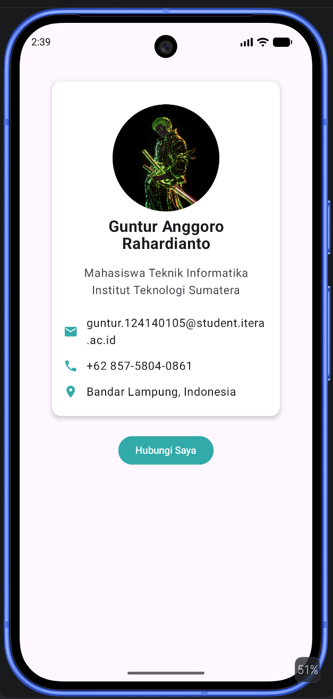
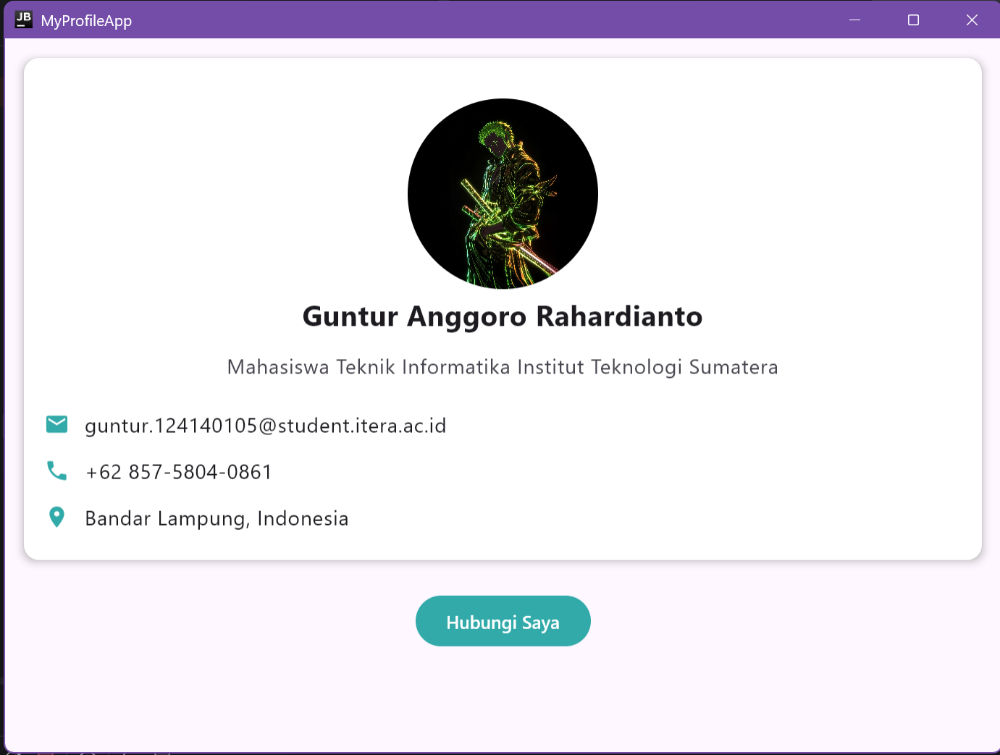

# My Profile App

Tugas Praktikum - Pengembangan Aplikasi Mobile  
Pertemuan 3: Compose Multiplatform Basics  
Nama : Guntur Anggoro Rahardianto  
NIM : 124140105  
Kelas : RB

## Fitur

1. **Halaman Profile** — menampilkan foto profil (circular), nama, bio, dan daftar informasi (Email, Phone, Location).
2. **3 Composable Functions reusable**:
  - `ProfileHeader` — foto profil (circular) + nama.
  - `InfoItem` — satu baris info (icon + value), dipakai berulang untuk Email, Phone, dan Location.
  - `ProfileCard` — menggabungkan `ProfileHeader`, bio, dan beberapa `InfoItem` di dalam `Card`.
3. **Komponen UI yang digunakan**: `Column`, `Row` (di dalam `InfoItem`), `Box` (pembungkus layar), `Card`, `Text`, `Button`, `Image`/`Icon`.
4. **Animasi**:
  - `AnimatedVisibility` dengan `fadeIn()` pada `ProfileCard` saat aplikasi pertama kali dibuka.
  - `animateColorAsState` pada tombol "Hubungi Saya" — warna tombol berubah gradual saat pesan ditampilkan/disembunyikan.

## Struktur Proyek

shared/src/commonMain/kotlin/org/example/project/  
├── App.kt # Entry point UI, merangkai ProfileCard + Button  
├── Profile.kt # Data class ProfileData  
├── ProfileHeader.kt # Composable: foto profil + nama  
├── InfoItem.kt # Composable: baris info (icon + value)  
└── ProfileCard.kt # Composable: gabungan Header + bio + info, dengan animasi fade-in  

## Cara Menjalankan

### Desktop
1. Buka project ini di Android Studio (`File > Open`).
2. Tunggu Gradle sync selesai.
3. Pilih run configuration **Desktop/JVM**, klik ▶ Run.

### Android
1. Pilih run configuration **Android App** (atau `composeApp`), klik ▶ Run.
2. Pilih emulator atau device fisik yang terhubung.

## Screenshot

**Android:**  

**Desktop:**  
