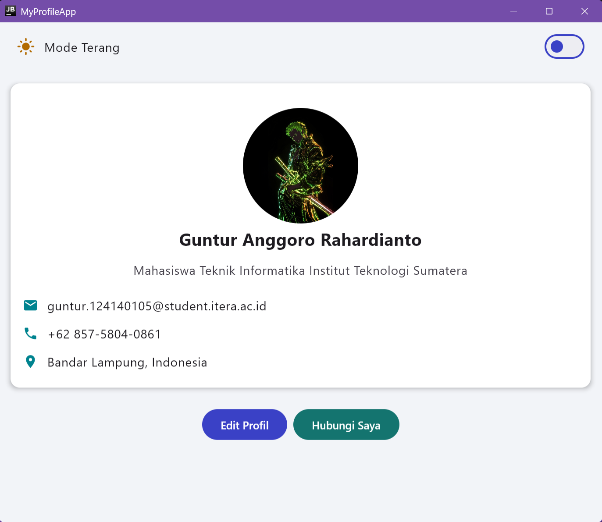
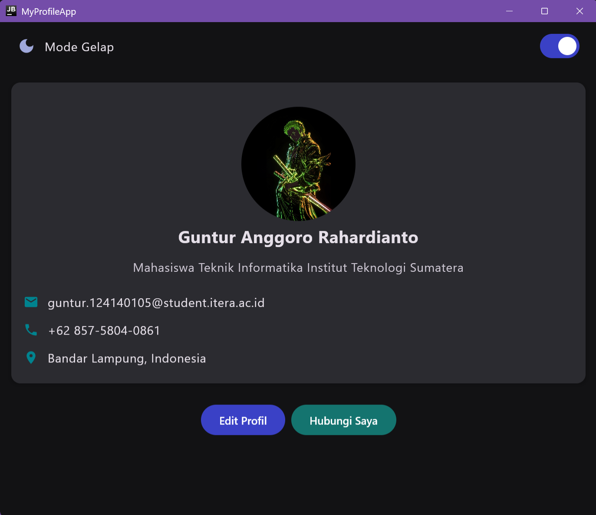
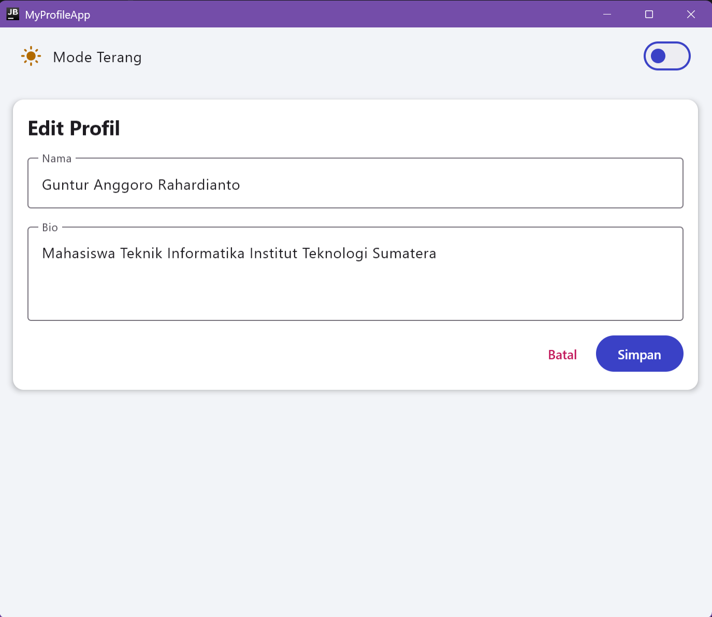
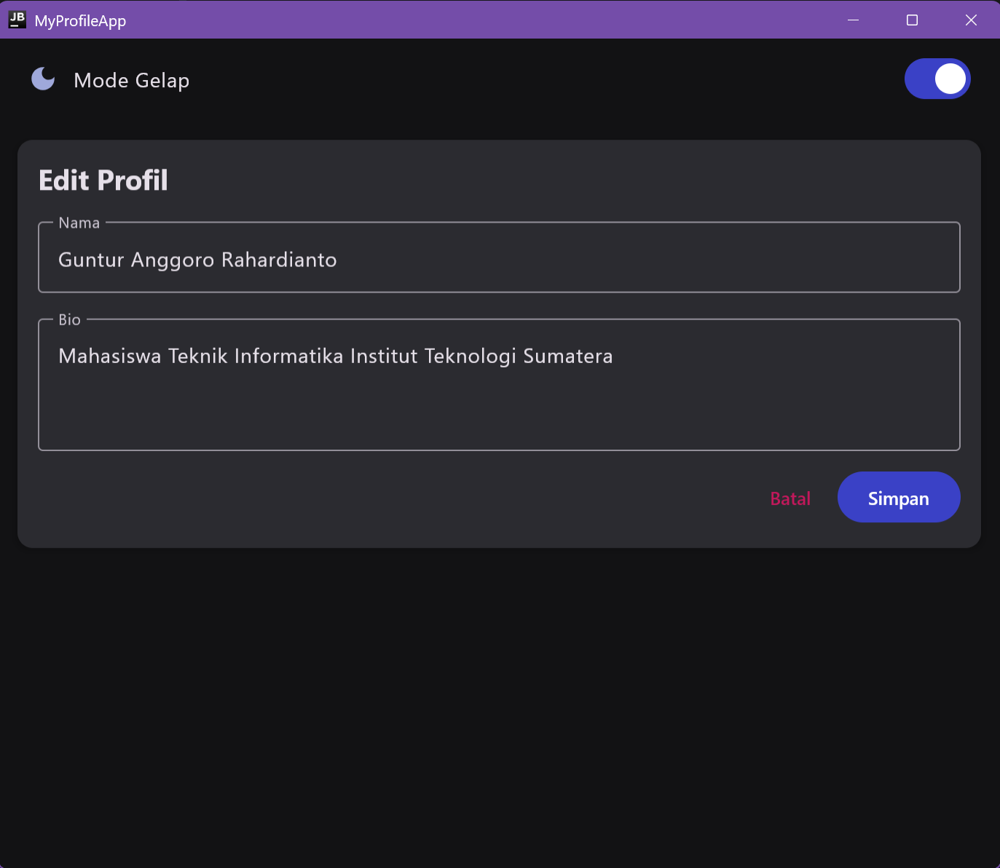

# My Profile App (Pertemuan 4: State Management dan MVVM)

Pengembangan dari Profile App Pertemuan 3 dengan arsitektur **MVVM** menggunakan **Compose Multiplatform**: state disimpan di `ProfileViewModel` (StateFlow), ditambah fitur edit profil dan dark mode.

Nama : Guntur Anggoro Rahardianto  
NIM : 124140105  
Kelas : RB

## Fitur

1. **MVVM Pattern**
   - `ProfileViewModel` menyimpan state dalam `MutableStateFlow` dan mengeksposnya sebagai `StateFlow`.
   - `ProfileUiState` (data class) menampung seluruh state layar: data profil, mode edit, dan dark mode.
2. **Edit Profile**
   - Form untuk mengedit nama dan bio.
   - State hoisting: `LabeledTextField` bersifat stateless (menerima `value` dan `onValueChange` dari parent).
   - Tombol Simpan memperbarui ViewModel. Tombol nonaktif jika nama kosong. Tombol Batal membuang perubahan.
3. **Dark Mode Toggle**
   - Switch untuk berganti mode terang/gelap, state `isDarkMode` disimpan di ViewModel.
   - Bonus: perpindahan tema dianimasikan dengan `animateColorAsState`.

Fitur dari Pertemuan 3 (foto profil circular, info kontak, animasi fade-in, `AnimatedVisibility`) tetap ada.

## Struktur Folder

shared/src/commonMain/kotlin/org/example/project/  
├── App.kt # Entry point UI, menghubungkan ViewModel dan UI  
├── data/  
│ └── Profile.kt # ProfileData (model)  
├── viewmodel/  
│ ├── ProfileUiState.kt # Data class UI state  
│ └── ProfileViewModel.kt # ViewModel dengan StateFlow  
└── ui/  
├── ProfileCard.kt  
├── ProfileHeader.kt  
├── InfoItem.kt  
├── LabeledTextField.kt # TextField stateless (state hoisting)  
├── EditProfileForm.kt # Form edit nama dan bio  
├── DarkModeToggle.kt # Switch dark/light mode  
└── theme/  
└── AppTheme.kt # Theme terang/gelap dengan transisi warna

## Cara Menjalankan

1. Buka folder ini di Android Studio (`File > Open`) dan tunggu Gradle sync selesai.
2. **Desktop**: pilih run configuration `desktopApp`, lalu klik Run. Atau lewat terminal: `.\gradlew :desktopApp:run`
3. **Android**: pilih run configuration `androidApp`, lalu pilih emulator atau device.

## Screenshot

**Light mode:**  

**Dark mode:**  

**Edit profile light mode:**  

**Edit profile dark mode:**  

